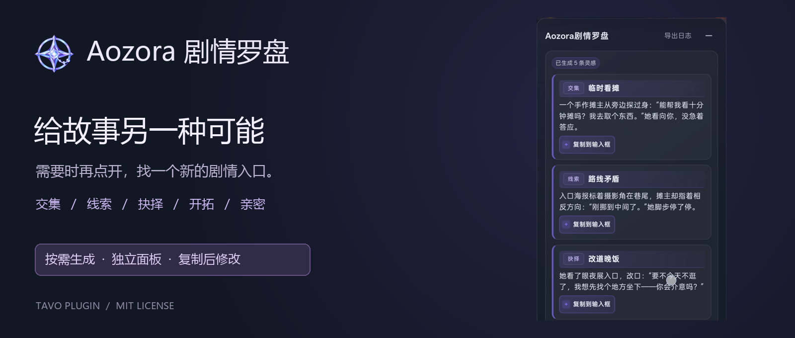
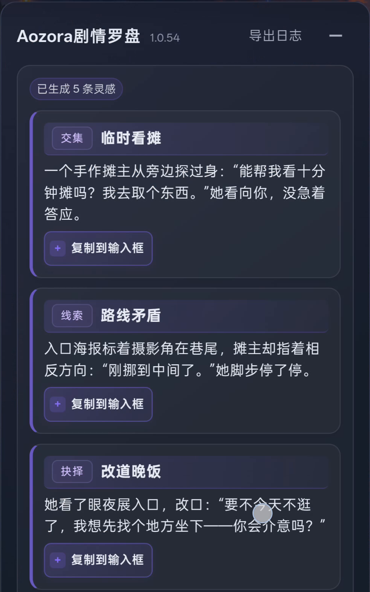
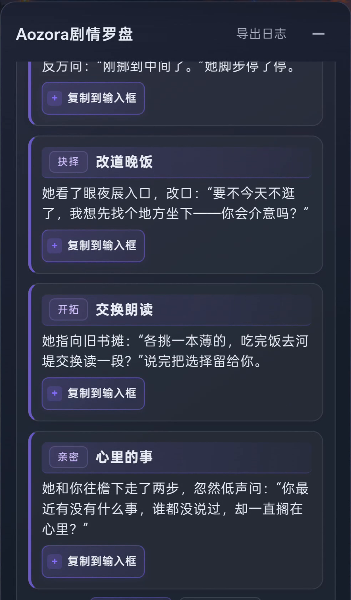
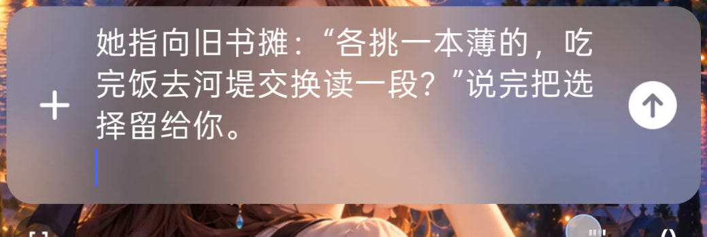
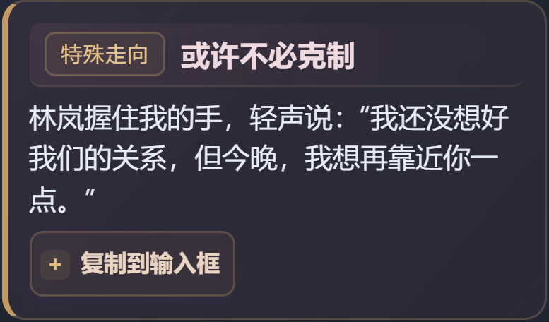

<div align="center">



# Aozora剧情罗盘 · Aozora Story Compass

故事还想继续，却不知道下一步？需要灵感时，再点开罗盘。

On-demand inspiration for your next roleplay moment.

[下载正式版 / Download](https://github.com/AozoraCynthiAStudio/Aozora-Tavo-Story-Compass/releases/latest) · [English](#english) · [MIT License](LICENSE)

</div>

## 它能帮你做什么？

聊得很投入，却总围着同一个人物、同一件事打转？世界书里还有很多角色和故事，但不知道怎样自然地碰上他们？

剧情罗盘结合最近剧情、可用记忆、人物卡与世界书中的相关资料，提供简短的剧情入口：一次人物交集、一条可追问的线索、一个不同的选择，或者一个现在就能提出的新活动。

它希望帮你找到想玩的下一步，而不是替你决定整个故事。你可以选一条、改写一条，也可以只借用其中一个点子。

## 和每轮附带选项的玩法有什么不同？

|你关心的事|剧情罗盘的做法|
|---|---|
|什么时候生成？|需要时主动点击，不跟正文同一轮输出。|
|显示在哪里？|独立面板，不向正文追加选项，不依赖正则叠加美化。|
|给什么内容？|五个固定路线的短灵感，尝试带来不同变化，而不只是替当前动作换说法。|
|选中就发出去吗？|不会。复制到输入框后，你可以继续修改，再自行发送。|
|等待时怎么办？|可以隐藏，后台继续生成；当前剧情仍有效时，成功完成后自动打开。|

独立面板减少了对正文美化的依赖，但不代表已验证兼容所有角色卡、主题和其他插件。

## 看看实际界面

以下常规界面来自实机录屏，展示正式版沿用的操作流程。介绍图片已移除旧版本号。

### 1. 需要灵感，再点开

在最新角色回复的操作区点击“剧情罗盘”。搜索时使用紧凑小窗，不用面对一整块空白面板。

<p align="center"></p>

*这是搜索动画片段的循环展示，不代表完整生成只需几秒。实际等待时间取决于模型、服务和上下文。*

### 2. 五个方向，找不同的剧情入口

|路线|它想打开什么？|
|---|---|
|交集|让另一位人物参与，建立新联系，打开人物圈子。|
|线索|带来可追问的信息、异常、发现或未完事项。|
|抉择|面对不同期待、边界、立场或取舍，留下不同可能。|
|开拓|从当下引出新活动、共同目标或新的去处。|
|亲密|符合人物与关系进度的靠近、信任、陪伴或亲密邀请。|

<p align="center">


</p>

例如这次实机结果里，“临时看摊”带来与摊主的新互动，“路线矛盾”留下可追问的问题；两张图是同一批结果的不同滚动位置。灵感是互相独立的备选，不是五件已经发生的事。

不满意可以点击“换一批”。它会尝试避开近期候选的事件核心、轮换出题角度；模型仍可能给出相似内容，不能保证每次都完全不同。

如果模型未写齐五条完整路线，会显示“灵感未生成完整”，可以直接重试；空白或仅有标题的内容不会作为完整结果展示。重试由你主动点击，不自动增加 API 调用。

### 3. 复制之后，还是你的故事

点击“复制到输入框”，面板收起，内容进入聊天输入框。你可以删改措辞、补自己的动作，也可以只保留一个想法。复制不会替你发送消息。

<p align="center"></p>

### 4. 特定剧情下，可能出现特殊走向

除了固定五条路线，当近期实际互动支持时，可能在最后追加一条不同配色的特殊走向，例如人物逐渐表达欲望、放开原有克制，或延续已有的关系变化。

亲密与欲望可以相互影响，不要求先有很高的好感；相关性化走向需要人物明确成年、双方自愿，并有实际剧情依据。黑化、立场转变等不会因为一次亲近就自动成立。

<p align="center"></p>

上图为特殊走向的界面示例，使用插件实际样式，并非模型实际生成的结果。示例人物均为成年人。特殊走向只在剧情条件合适时可能出现，不是每轮必出。

### 5. 等待时可以隐藏

不必一直盯着搜索框。点击“隐藏”后会继续生成，同一剧情成功完成后自动打开。如果切换聊天或剧情已经变化，不会自动弹出旧结果；隐藏不等于取消请求。

## 安装与使用

需要 Tavo 1.3.0 或更高版本，并已配置可用的文本 AI。

1. 前往 [Releases](https://github.com/AozoraCynthiAStudio/Aozora-Tavo-Story-Compass/releases/latest)，下载 `.tpg` 插件文件，不是 GitHub 自动生成的 Source code 压缩包。
2. 在 Tavo 的插件管理中导入并启用。
3. 打开聊天，在最新角色回复的操作区点击“剧情罗盘”。
4. 等待结果，选择灵感，复制到输入框后修改并自行发送。

## 适合谁，以及当前的边界

适合需要时找点新思路、想认识其他人物、探索线索或改变关系进展的玩家。如果你希望每轮正文都自动附带选项，这款插件的交互方式可能不适合你。

- 额外 API 调用：每次生成或换批都会单独调用一次文本 AI，消耗对应服务的额度或费用。
- 等待时间会变化：模型、服务响应和上下文都可能影响速度，不承诺固定秒数。
- 需要核对内容：资料可能不完整，模型也会遗漏或误解记忆、人物身份与时间；选项是灵感，不是已确认的故事事实。
- 发散不等于无约束：允许符合世界规则的合理新事件，但仍可能出现重复、牵强或与设定不符的候选，请自行取舍。

## 遇到问题如何反馈？

可以通过面板右上角的“导出日志”保存诊断文件，再到 [Issues](https://github.com/AozoraCynthiAStudio/Aozora-Tavo-Story-Compass/issues) 描述现象、版本和复现步骤。剧情问题最好说明“当前实际发生了什么”和“选项哪里不符”。

插件诊断日志默认不保存聊天、人物卡、世界书或完整生成原文。Tavo 自身的上下文日志是另一种文件，可能包含实际提示和剧情资料；公开提交前请自行检查、删去私人信息。无需公开整套角色卡或聊天记录。

## English

### What is Story Compass?

An on-demand inspiration plugin for Tavo RP. When a scene feels stuck, open the compass to explore a new encounter, clue, choice, activity, or relationship moment. It uses the recent scene and relevant available memory, character, and worldbook material to suggest short story entrances—not a complete storyline or predetermined outcome.

### How it works

1. Click the compass action on the latest character reply when you need inspiration. It makes a separate AI request, rather than attaching choices to every normal response.
2. Browse five routes in a dedicated panel: Encounters, Clues, Choices, Exploration, and Intimacy. The UI does not depend on regex-based decoration inside story text.
3. Copy a suggestion into the composer, edit it, and decide when to send. Copying does not send it automatically.
4. An optional, visually distinct special path may appear when supported by the actual story. Sexualized paths require clearly adult, consenting characters; changes in allegiance or morality require their own story basis.
5. Hide the panel while waiting. Successful results reopen automatically if the same scene remains current. Hiding does not cancel the request.

The regular screenshots and loading animation show the actual workflow retained in the formal release. Outdated version labels have been removed from the presentation images. The special-path card is an authored UI example, not a real model response. The loading GIF is a short loop, not a latency claim.

### Install

Requires Tavo 1.3.0+ and a configured text AI service. Download the `.tpg` asset from [Releases](https://github.com/AozoraCynthiAStudio/Aozora-Tavo-Story-Compass/releases/latest), import and enable it in Tavo, then open the compass from the latest character reply.

### Limitations and feedback

Each generation or reroll makes an additional text AI call. Cost and latency depend on your model, provider, and context. Suggestions may repeat ideas or misunderstand memory, identities, time, or other story facts; review and edit them. Compatibility with every theme or third-party plugin is not guaranteed.

If fewer than five complete regular routes are returned, the panel shows an incomplete-result state with a retry button. Empty or metadata-only cards are not displayed as successful results. Retries require a manual click; no automatic extra request is made.

Export diagnostic logs from the panel and report reproducible problems in [Issues](https://github.com/AozoraCynthiAStudio/Aozora-Tavo-Story-Compass/issues). Plugin diagnostics do not save full story or prompt text by default. Tavo context logs are separate and may contain private material: review before sharing.

## Source & build / 源码与打包

Runtime files live in `plugin/`. On Windows, with Node.js installed:

```powershell
powershell -File scripts/build.ps1
```

The script checks JavaScript syntax and creates a `.tpg` package plus SHA-256 checksum in `dist/`. No npm dependencies are required for packaging. These checks verify packaging, not model quality or compatibility on every device.

Run parser/completeness regression checks with `node tests/options.test.cjs`.

## License & screenshots / 授权与截图

[MIT License](LICENSE) © 2026 AozoraCynthiA.

The MIT license applies to this plugin's code. Story text, character cards, presets, and backgrounds visible in user-provided screenshots are demonstration context; they are not bundled with the plugin or relicensed as third-party content.

MIT 授权适用于插件代码。实机截图中的故事、角色卡、预设和背景用于说明使用场景，不代表插件附赠这些内容，也不改变第三方内容原有的授权。
